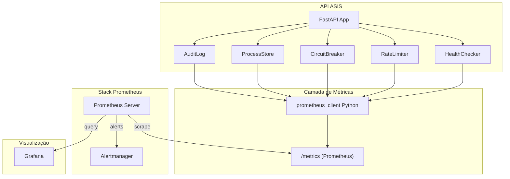
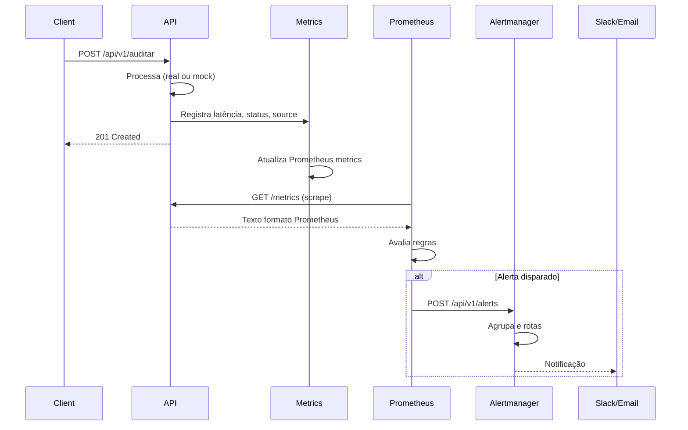

# Plano de Integração Prometheus com API ASIS

## Contexto e Objetivos

A API ASIS ([`g06/src/core/api.py`](g06/src/core/api.py)) já possui mecanismos de observabilidade internos (HealthChecker, RateLimiter, CircuitBreaker) e um endpoint `/api/v1/health`. O objetivo é expor essas métricas em formato Prometheus, coletar dados dinâmicos da API (com fallback para mock), configurar alertas conforme SLAs/DNs da documentação e estruturar dados para o **Dashboard da Qualidade como ativo de software**.

---

## 1. Arquitetura da Solução

---

## 2. Data Models e Métricas por BD/DN

### 2.1 Mapeamento BD/DN → Métricas Prometheus

| Direcionador | SLA/Limiar Documentado | Métrica Prometheus | Tipo | Labels Sugeridas |
|--------------|------------------------|--------------------|------|------------------|
| **DN1** (Latência) | P90 ≤ 500ms, Alerta 650ms | `asis_request_duration_seconds` | Histogram | `endpoint`, `method`, `status`, `source` (real/mock) |
| **DN2** (Integridade) | Rejeição HTTP 400 | `asis_validation_errors_total` | Counter | `validation_type`, `field` |
| **DN3** (Disponibilidade) | Taxa erro < 30%, Rate 10 req/min | `asis_health_error_rate`, `asis_rate_limit_remaining` | Gauge | `account_key_hash` |
| **DN3** (Circuit Breaker) | 5 falhas → OPEN | `asis_circuit_breaker_state` | Gauge | `state` |
| **DN4** (Não-Repúdio) | 100% assinaturas | `asis_audit_log_entries_total`, `asis_nr_alerts_total` | Counter | `alert_type` |
| **RNF1** (Capacidade) | P95 ≤ 600ms, 50 req concorrentes | `asis_concurrent_requests` | Gauge | - |

### 2.2 Métricas Específicas para o Dashboard da Qualidade

Alinhadas ao **Catálogo de serviços** e **Quadro de dados estatísticos**:

| Categoria do Dashboard | Métrica Prometheus | Descrição |
|------------------------|--------------------|-----------|
| **Mapa de serviços** | `asis_services_up{service="auditar"}` | Status dos endpoints por componente |
| **Execuções** | `asis_requests_total`, `asis_requests_duration_seconds` | Requisições por endpoint |
| **Registros gerados** | `asis_process_store_size`, `asis_audit_log_size` | Tamanho do ProcessStore e AuditLog |
| **Massa de testes** | `pytest_tests_total`, `pytest_tests_passed` | Exporter HTTP em `pytest_metrics_exporter.py` (modelo Pull) |

### 2.3 Labels Recomendados

- `endpoint`: `/api/v1/auditar`, `/api/v1/auditar/resilient`, `/api/v1/auditar/nr`, `/api/v1/health` etc.
- `method`: `GET`, `POST`
- `status`: `success`, `error`, `validation_error`
- `source`: `real` (API ASIS) ou `mock` (fallback)
- `dn`: `DN1`, `DN2`, `DN3`, `DN4` (traceabilidade)
- `account_key_hash`: SHA-256 truncado para isolamento por tenant (sem expor chave)

---

## 3. Implementação Técnica

### 3.1 Endpoint `/metrics` na API

- Adicionar `prometheus_client` ao `requirements.txt`.
- Criar módulo `src/core/metrics.py` com:
  - Histograma de latência por endpoint
  - Contadores de requisições (sucesso/erro/validação)
  - Gauges para `health_checker`, `rate_limiter.remaining()`, `circuit_breaker.state`
  - Contadores para `process_store`, `audit_log.size()`
  - Middleware ou decorator para instrumentar endpoints automaticamente
- Registrar endpoint no FastAPI: `app.add_route("/metrics", prometheus_client.make_asgi_app())`

### 3.2 Fallback para Mock

- A API já usa fallback para mock quando `asis_upload_file()` falha (exceção).
- As métricas devem registrar `source="mock"` ou `source="real"` via label no histograma de latência.
- O endpoint `/metrics` sempre expõe o estado atual (singletons em memória); não depende de API externa.

### 3.3 Configuração Prometheus

- `prometheus.yml`: scrape da API em `http://localhost:8000/metrics` (ou variável de ambiente).
- Job de scrape para a API ASIS com intervalo de 15s.
- Job de scrape para métricas pytest em `http://localhost:9092/metrics` (exporter `pytest_metrics_exporter.py`).

### 3.4 Regras de Alerta (Alertmanager)

| Alerta | Condição PromQL | Severidade | DN/SLA |
|--------|-----------------|------------|--------|
| `HighLatency` | `histogram_quantile(0.9, asis_request_duration_seconds)` > 0.65 | warning | DN1 (650ms) |
| `SLAViolation` | `histogram_quantile(0.9, ...)` > 0.5 | critical | DN1 (500ms) |
| `HighErrorRate` | `asis_health_error_rate` > 30 | warning | DN3 |
| `CircuitBreakerOpen` | `asis_circuit_breaker_state{state="OPEN"}` == 1 | critical | DN3 |
| `RateLimitLow` | `asis_rate_limit_remaining` < 3 | warning | DN3 |
| `AuditChainAlert` | `asis_nr_alerts_total{alert_type="chain"}` > 0 | critical | DN4 |

---

## 4. Sistema de Alertas (Alertmanager)

- Configurar `alertmanager.yml` com:
  - `group_by`: `['alertname', 'severity']`
  - `repeat_interval`: 5m
  - `receiver`: Slack, email ou webhook (configurável)
- Integrar com `prometheus.yml` via `alerting.alertmanagers`.

---

## 5. Camada de Visualização

### 5.1 Uso dos Dados no Dashboard

Os dados Prometheus podem ser consumidos por:

1. **Grafana**: Dashboards com queries PromQL (ex: `rate(asis_requests_total[5m])`).
2. **API Grafana**: Exportar dashboards como JSON (código como ativo).
3. **Relatórios**: Prometheus pode ser consultado via HTTP API para gerar relatórios estáticos (PDF/HTML) em pipelines CI.

### 5.2 Painéis Sugeridos para o Dashboard da Qualidade

- **Mapa de serviços**: Mapa de calor ou tabela de `asis_services_up` por endpoint.
- **Estatísticas de execuções**: Gráfico de taxa de requisições, latência P95/P99.
- **Estatísticas de registros**: `asis_process_store_size`, `asis_audit_log_size` ao longo do tempo.
- **Estatísticas de massa de testes**: `pytest_tests_total`, `pytest_tests_passed` (exporter em `:9092/metrics`).

---

## 6. Tarefas Objetivas (Alinhadas ao Artefato)

### 6.1 Catálogo de Serviços e Componentes Monitorados [5.0 pts]

| Task | Descrição | Entregável |
|------|-----------|------------|
| **T1** | Criar catálogo de serviços e componentes monitorados | Documento `docs/catalogo_servicos_monitorados.md` com mapeamento endpoint → DN → métrica |
| **T2** | Implementar endpoint `/metrics` e módulo `metrics.py` | Código em `src/core/metrics.py` com todas as métricas DN1-DN4 |
| **T3** | Instrumentar endpoints com labels `endpoint`, `source` (real/mock) | Middleware ou decorator em `api.py` |

### 6.2 Quadro de Dados Estatísticos [5.0 pts]

| Task | Descrição | Entregável |
|------|-----------|------------|
| **T5** | Métricas de execuções, erros e alertas | Histogramas, counters e gauges já definidos em T2 |
| **T6** | Métricas de massa de testes | Exporter `src/scripts/pytest_metrics_exporter.py` — servidor HTTP em `:9092/metrics` (modelo Pull) |
| **T7** | Métricas de registros gerados | `asis_process_store_size`, `asis_audit_log_size` em `metrics.py` (atualizados no endpoint `/metrics`) |

### 6.3 Infraestrutura e Alertas

| Task | Descrição | Entregável |
|------|-----------|------------|
| **T8** | Configuração Prometheus (`prometheus.yml`) | Arquivo com `scrape_configs` e `rule_files` |
| **T9** | Regras de alerta (`rules.yml`) | Arquivo com regras PromQL para DN1, DN3, DN4 |
| **T10** | Configuração Alertmanager | `alertmanager.yml` com receivers e rotas |
| **T11** | Docker Compose (opcional) | `docker-compose.yml` com Prometheus + Alertmanager + API + Grafana |

### 6.4 Documentação e Visualização

| Task | Descrição | Entregável |
|------|-----------|------------|
| **T12** | Documentar Dashboard da Qualidade | `docs/dashboard_qualidade.md` com painéis, queries PromQL e rastreabilidade BD/DN |
| **T13** | Template Grafana (JSON) | Dashboard exportável como ativo de software |

---

## 7. Fluxo de Execução

---

## 8. Dependências e Arquivos Principais

- **Novos arquivos**: `src/core/metrics.py`, `src/scripts/pytest_metrics_exporter.py`, `prometheus.yml`, `rules.yml`, `alertmanager.yml`, `docs/catalogo_servicos_monitorados.md`, `docs/dashboard_qualidade.md`
- **Arquivos modificados**: `src/core/api.py`, `requirements.txt`
- **Dependência**: `prometheus-client>=0.19.0`

---

## 9. Referências

- [Prometheus Overview](https://prometheus.io/docs/introduction/overview/)
- Documentação do projeto: [`g06/docs/projeto.md`](g06/docs/projeto.md) (DN1-DN4, RNF1-RNF3, SLAs)
